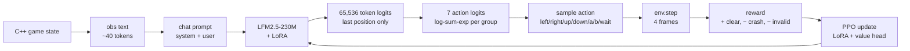

# Canyon Racer → C++ → PPO language-model agent

A macOS-friendly C++17 port of the **game logic** of
[bbbbbr/canyon-racer](https://github.com/bbbbbr/canyon-racer) (Game Boy,
GBDK-2020), plus a PPO trainer that plays the port with
**LiquidAI/LFM2.5-230M**.

Only gameplay is ported: ship physics, canyon walls, obstacles, scoring,
levels, the SCX canyon-wave scroll, lives and rewind. Rendering, music, SFX,
menus, input hardware, cart saves and scanline effects are not.

```
canyon_rl/
├── cpp/
│   ├── include/canyon/game.hpp   game state + constants
│   ├── src/game.cpp              ported gameplay loop
│   ├── src/scx_tables.cpp        canyon wave data (generated from original)
│   ├── src/env_c_api.cpp         C ABI used by Python/ctypes
│   ├── tests/tests.cpp           port verification
│   └── Makefile
├── scripts/gen_scx_tables.py     extracts wave tables from the original source
└── python/
    ├── canyon_env.py             ctypes env + text observation
    ├── actions.py                token → action mapping
    ├── agent.py                  LM policy (LoRA), system prompt, action groups
    ├── train_ppo.py              PPO training
    ├── eval.py                   greedy evaluation of a checkpoint
    └── play_demo.py              token-by-token play trace
├── modal_train.py                Modal GPU launcher (train + eval)
```

## Build and verify the port

```sh
make -C cpp test     # physics, collisions, spawns, scoring, rewind, determinism
make -C cpp lib      # cpp/libcanyon_env.dylib for Python
```

`cpp/tests/tests.cpp` checks the parts a user can observe: jump height for a
tap vs. hold, horizontal speed (0.5 px/frame), the 180-frame opening delay,
wall crash → rewind → life accounting, game over, level-ups, seeded layout
determinism and observation ordering.

### Fidelity notes

Transcribed 1:1 from `gameplay.c`, `entity_ship.c`, `entity_obstacles.c`,
`entity_collisions.c`, `level.c`, `map_fx.c`, `lives.c`, `score.c` and
`common.c`:

- 8.8 fixed point; ship 0.5 px/frame; jump velocity 800 with gravity 32 and the
  350 release clamp; collision only on the ground and only when not invincible.
- Ships collide using `ship_y + 16` into the SCX wave table, canyon base x 64,
  width 32; obstacle hitboxes by type; items restore one life.
- Obstacles: 5-entry FIFO ring, speeds 500/550/575/597 (÷256 px per frame),
  removal at y > 144, double-spawn bit, ~3% item spawn, spawn delay 180 frames.
- 16-entry level table, level-up every 10 scored obstacles, score +10.
- Rewind snapshot includes the RNG seed; crash consumes a life; 90 frames of
  invincibility after a rewind; `b` saves a checkpoint for one life.
- GBDK `rand()`: 16-bit LCG `x = 17x + 0x5C93`, returning the high byte.

Known deviations, all deliberate:

| Item | Original | Port |
|---|---|---|
| Frame pacing / VBlank | real 60 Hz hardware ISR | one `step()` = one frame |
| `sys_time` parity at gameplay start | depends on intro/menu time | starts at 0 |
| Crash animation | 128 frames | faithful by default; RL uses `fast_crash` |
| RNG seed | fixed `0x1234` every round | optional `seed` for RL; 0 = original |
| Presentation | sprites, audio, fades, pause | omitted |

`seed != 0` changes obstacle/canyon layouts for training and evaluation;
`seed == 0` reproduces the original deterministic opening.

### Observation (game state, not pixels)

`CanyonEnv.step()` returns the state after the action, with ship/canyon
positions, three look-ahead canyon rows, and up to three nearby obstacles
relative to the ship (`dy`, `d_l`, `d_r`). `obs_text()` renders it compactly:

```
t=123 lvl=0 score=0 lives=1 inv=0 spd=500
ship x=68 y=112 z=0 st=ground
canyon 64..96 dx=-12 gl=12 gr=12
front 64..96 64..96 64..96
obs dy44 middle 72..88 dl4 dr20
```

## Language-model agent



- **System prompt**: rules, button semantics (including "hold a to jump
  higher", "wait releases a button") and the exact reply format.
- **Action space**: seven actions (`wait, left, right, up, down, a, b`).
  Each action is a group of vocabulary tokens (`left`, ` Left`, ...).
  The LM's 65,536-way next-token distribution is reduced per action with
  log-sum-exp, so the policy is a proper 7-way categorical derived from LM
  tokens.
- **Invalid output**: probability mass on any token outside the seven action
  groups is "anything else". It is measured as `invalid_mass`, added as a
  negative reward term and as a differentiable loss term, so the model is
  pushed to spend its token probability on action words only. With the reply
  hint in the user message the base model already emits valid words ~99.7% of
  the time; the penalty is what keeps it there. At deployment the emitted word
  is the highest-probability token of the chosen group.
- **Exploration**: ε-mix (ε=0.2) between the LM action distribution and a
  uniform distribution over the seven actions, applied identically in the
  rollout and the PPO ratio.
- **Adaptation**: LoRA (r=8, all linear layers, 1.9M trainable parameters) on
  LFM2.5-230M. Full-model Adam on a 65k-way head moves logits by ~20 nats per
  step and collapses the policy; LoRA at 2e-6 changes them by ~0.1 nat.
- **PPO**: GAE(γ=0.995, λ=0.95), clipped surrogate (ε=0.2), entropy bonus,
  scalar value head on the LM's last hidden state, minibatches over prompts.
  Reward: +1 per obstacle cleared, +5 per item, −1 per crash, +0.002/frame,
  minus `0.2 × invalid_mass` per decision.
- Action is held for 4 frames (15 decisions/second of game time), so a jump is
  a short sequence of `a` decisions.

## Train / evaluate

Python 3.13+ with PyTorch (MPS), Transformers and PEFT. LoRA training on a
230M model fits in a few GB of unified memory with `logits_to_keep=1`.

```sh
python3 -m venv .venv
. .venv/bin/activate
pip install -r requirements.txt

python python/test_env.py                           # env wrapper checks (no model)
python python/train_ppo.py --smoke                  # end-to-end check (~1 min)
python python/train_ppo.py --iters 40 --eval-every 5 --save
python python/eval.py python/runs/ppo/policy.pt --episodes 8 --verbose
python python/play_demo.py python/runs/ppo/policy.pt --seed 7
```

`play_demo.py` prints the token the model emits, the mapped action, the value
estimate, and crash/rewind events for one episode.

Metrics are appended to `python/runs/ppo/metrics.csv`; checkpoints keep only
the LoRA weights and heads (~8 MB). Evaluation is greedy over the seven
actions on held-out seeds (layouts the policy was not trained on).

### Warm start: expert -> SFT -> PPO

Pure PPO from the base model did not learn to use the game state: after 50k
decisions the greedy action probabilities were essentially the same for
`gl=30 gr=2` and `gl=2 gr=30`, so the ship drifted into whichever wall was
closer. The fix is a short supervised warm start from a rule-based teacher:

```sh
python python/expert.py 10          # inspect the teacher (mean ~3150 frames)
python python/sft.py collect --episodes 40 --max-steps 1200
python python/sft.py train --data sft_data.pt --out python/sft.pt \
    --epochs 1 --lr 1e-4 --device mps --max-steps 1200
python python/eval.py python/sft.pt --episodes 8 --seed-start 2000
```

The teacher keeps wall margins (`WALL_MARGIN=10`) and jumps when an
overlapping obstacle is within 34 px (`JUMP_HOLD=3`); SFT clones its action
distribution into the LM's seven-way action head. 1200 steps with label
smoothing 0.05 (`--label-smooth 0.05`) keep the policy entropy at 0.24
instead of saturating it, which is what lets PPO keep learning; greedy
evaluation is 2489 frames / 222.5 score / 30.5 obstacles on the four trainer
seeds, and PPO from that checkpoint (`main11`, `lm_lr 1e-6`, epsilon 0.05,
`ent_coef 0.01`) improves it to 2640 frames / 242.5 score / 33 obstacles by
iteration 10. A sharper SFT4 (no label smoothing) plays slightly better
(2770 / 242.5 / 35.25 on the four trainer seeds) but its action
probabilities are ~1.0, so the PPO gradient vanishes and the greedy policy
does not move.

On the 16 test seeds 1000-1015 (1200-decision cap, the honest comparison
against the teacher's 2835 frames / 165 score), SFT4 gets 2553 frames /
186.25 score / 32.44 obstacles and main11 at iteration 30 gets 2546.7 /
165.0 / 31.75. The main11 checkpoint at iteration 190 reaches **4294.2
frames / 481.9 score / 60.5 obstacles** (11/16 seeds at the 4800-frame cap,
best score 810); iteration 270 measures 4077.3 / 445.6 / 55.75 (10/16 at the
cap), i.e. the policy fluctuates around the same strong plateau. The four trainer seeds
are a favourable subset (SFT4 3070 / 282.5; main11 iter 190 3600 / 485 /
48.5, all four at the cap). Uncapped (episode ends on the second crash, not
the decision cap) the iter-190 policy on the four trainer seeds averages
**9,000.8 frames / 672.5 score / 134.5 obstacles / level 4.5**; per seed:
1000 -> 6,610 / 590 / level 3, 1137 -> 5,558 / 540 / level 1,
1274 -> 10,446 / 890 / level 8, 1411 -> 13,389 / 670 / level 6, and seed
1011 -> 10,928 / 950 / 190 obstacles / **level 9** at iteration 190; the
iteration-320 checkpoint goes 11,368 frames / 1,010 score / 202 obstacles /
**level 10** on seed 1011 with no decision cap. The capped numbers above
understate the policy substantially.

A state-vector MLP PPO teacher (`python/ppo_teacher.py`, 64 features, 4
actions, 33M steps in ~10 min on CPU) was also tried: it survives 4670 frames
but scores only 123.8 (it farms crash-rewinds), and distilling it for 1200
steps reaches just 758 val accuracy and 1942 frames, below the expert. The
tuned expert remains the better teacher.

### Train on a Modal GPU

A laptop MPS run is the wrong tool for a 230M-parameter PPO loop. The same
trainer runs on Modal with one command; the image builds the Linux C++ library,
installs PyTorch/Transformers/PEFT, and keeps checkpoints and the HF cache in
volumes.

```sh
pip install modal
modal setup                    # one-time browser login

# 300 iters x 32 envs x 128 steps, L4 GPU, ~2-4 h
modal run modal_train.py

# close the laptop while it trains
modal run --detach modal_train.py

# any train_ppo.py flag can be overridden
modal run modal_train.py --args "--iters 500 --envs 48 --minibatch 64 --run big"
CANYON_GPU=A10G modal run modal_train.py --args "--run a10g"

# evaluate a saved checkpoint on the remote GPU
modal run modal_train.py --args "--mode eval --ckpt /outputs/runs/modal/policy.pt"

# fetch results
modal volume get canyon-racer-rl runs/modal ./runs/modal
```

Defaults: `L4` (24 GB), 300 iterations, 32 envs, 128-step rollouts, 2 PPO
epochs, minibatch 64, `lm_lr 1e-5`, `epsilon 0.25`, checkpoint every 25
iterations. Set `CANYON_GPU=A10G` (or `A100`) before `modal run` to change the
GPU.

Two prerequisites live outside the repo:

- `modal setup` authenticates the CLI.
- The Modal workspace must not be paused. A paused workspace is an account
  state (billing/plan) and cannot be unpaused from the CLI; `modal run` fails
  with `Workspace ... is paused`. Reactivate it in the Modal dashboard.

If `--args` is awkward in your shell, the launcher also reads `CANYON_ARGS`:

```sh
CANYON_ARGS="--iters 500 --envs 48 --run big" modal run modal_train.py
```

### Status

Verified on this machine (Apple Silicon, MPS, 16 GB):

- port tests, ctypes env tests, token grouping (48 vocabulary ids → 7 actions),
  prompt/token sampling, PPO updates (non-zero KL), checkpoint round-trip and
  greedy evaluation;
- untrained greedy policy: `left` every turn, dies at frame 184 (score 0);
- PPO from the base model on a Modal GPU (1.23M decisions, `lm_lr 1e-6`,
  `epsilon 0.25`) reaches ~200-240 training frames and a greedy 198-372
  frames, but its action probabilities barely change with `gl`/`gr`: the LM
  token logits are dominated by the language prior, so the ship keeps
  drifting into walls;
- the expert warm start fixes that. The final teacher (wall margin 10,
  jump at 34 px, 3-decision jump hold) averages 3149 frames / 200 score on
  seeds 0-11; 1200 SFT steps reach validation accuracy 0.997 and a greedy
  policy of 3070 frames / 282.5 score / 40.25 obstacles on the four eval
  seeds (seed 1274 survives the 1200-decision cap). PPO resumes from that
  checkpoint.

### Final long run (stopped at iteration 368)

PPO resumed from the label-smoothed SFT7 checkpoint (`runs/sft/sft7b.pt`),
600 iterations (1.23M decisions), epsilon 0.05, `lm_lr 1e-6`, entropy
coefficient 0.01, KL early stop at 0.05:

```sh
modal deploy modal_train.py
python - <<'PY'
import modal
args = ("--iters","600","--envs","64","--horizon","32","--epochs","1",
        "--minibatch","32","--lm-lr","1e-6","--head-lr","2e-4","--epsilon","0.05",
        "--target-kl","0.05","--lives","1","--bf16","--eval-every","10",
        "--eval-episodes","4","--save-every","10","--lora-rank","8",
        "--invalid-reward","0.05","--ent-coef","0.01",
        "--resume","/outputs/runs/sft/sft7b.pt",
        "--device","cuda","--out-dir","/outputs/runs/main11","--save")
modal.Function.from_name("canyon-racer-ppo","train").spawn(args, "/outputs/runs/main11")
PY
```

The spawn is server-side, so the run survives a laptop sleep or client exit.
Checkpoints and metrics land in `runs/main11` on the `canyon-racer-rl`
volume; the supervisor restarts from `policy_latest.pt` if the process dies.

Measured through iteration 199: approx KL 1e-4..1.4e-3, entropy 0.25 ->
0.87, invalid token mass 0.43 -> 0.04, clip fraction <0.02. The greedy eval
moved from the SFT7 base's 2489 frames / 222.5 score / 30.5 obstacles to
2640 / 242.5 / 33 at iteration 10, plateaued through 60, then broke through
as the soft policy's argmax shifted: 3600 frames / 452.5 score / 48 obstacles
at iteration 120 and 3600 / 485 / 48.5 at 190 on the four trainer seeds —
i.e. all four survive the full 900-decision evaluation cap.

The run was stopped at iteration 368 (753,664 steps) and the final checkpoint
was pulled to `runs/main11/policy_latest.pt`. Final metrics row: eval mean
1,410 frames / max score 162 (best 420), invalid token mass 0.020, entropy
0.937, clip fraction 0.003. On seed 1011 the greedy policy scores 480 frames
/ 50 at 120 decisions and 1600 / 210 at 400 decisions; the Q8 llama.cpp
export matches both (`canyon-server/`).

`gl`/`gr` are the exact pixel margins between the ship hitbox and the canyon
walls; negative means already colliding. The action prior is trainable: the
base model puts ~99% on `left`, which saturates the gradient, so the initial
prior flattens the policy to roughly `left 0.50 / right 0.40`.

## License / attribution

The original game is © 2023 bbbbbr, licensed **CC-BY-NC-SA 4.0**; this port and
the generated wave tables are derivative works under the same license. See
`NOTICE`.